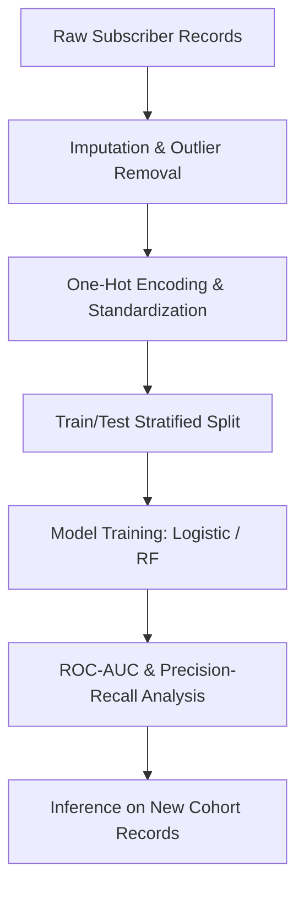

# Customer Churn Prediction and Retention Analytics

> Machine learning classification model identifying customer churn drivers to guide proactive retention.

[](https://github.com/sohailahmed-bsrh/customer-churn-prediction)
[](https://sohail.devsil.com/projects.html)
[](https://sohail.devsil.com)

---

## Overview

Customer acquisition costs substantially exceed retention costs, making early identification of at-risk subscribers critical to business viability.

This project provides an end-to-end, reproducible implementation engineered to solve this challenge through verified data transformations, reliable algorithms, and production-ready architecture.

---

## Key Features

- Extensive exploratory data analysis isolating contract tenure, billing methods, and service usage drivers
- Feature scaling and one-hot encoding on categorical customer attributes
- Comparative evaluation across Logistic Regression, Decision Trees, and Random Forest models
- Precision-recall tradeoff analysis optimizing classification thresholds for business intervention

---

## System Architecture



---

## Technology Stack

| Technology | Version / Spec | Role in Architecture |
| :--- | :--- | :--- |
| **Python** | `3.10+` | Data manipulation and scientific computing |
| **Pandas & NumPy** | `2.0+` | Dataframe transformation and array operations |
| **Scikit-learn** | `1.3+` | Supervised estimators, validation splits, and metrics |
| **Matplotlib & Seaborn** | `3.7+` | Feature importance and correlation heatmaps |

---

## Repository Structure

```text
customer-churn-prediction/
|-- notebooks/
|   `-- customer_churn_analysis.ipynb
|-- data/
|-- .gitignore
|-- requirements.txt
`-- README.md
```

---

## Installation and Execution

### Prerequisites
- Python 3.10 or higher
- Git version control
- Virtual environment manager (`venv`)

### Setup Instructions
1. Clone the repository:
```bash
git clone https://github.com/sohailahmed-bsrh/customer-churn-prediction.git
cd customer-churn-prediction
```

2. Configure environment and dependencies:
```bash
python -m venv venv
source venv/bin/activate  # On Windows: venv\Scripts\activate
pip install -r requirements.txt
jupyter notebook notebooks/customer_churn_analysis.ipynb
```

---

## Interface and Verification
The system produces verifiable execution logs, prediction matrices, or interactive browser interfaces depending on the target mode. Verify operation by executing the commands specified above or inspecting the demonstration notebooks.

---

## Author and Contact
Developed by **Sohail Ahmed** — Full Stack AI Engineer & Machine Learning Specialist.
- **Portfolio:** [sohail.devsil.com](https://sohail.devsil.com)
- **GitHub:** [@sohailahmed-bsrh](https://github.com/sohailahmed-bsrh)
- **Email:** [sohail.bsrh@gmail.com](mailto:sohail.bsrh@gmail.com)
